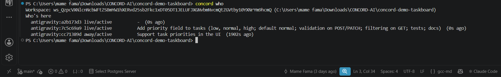
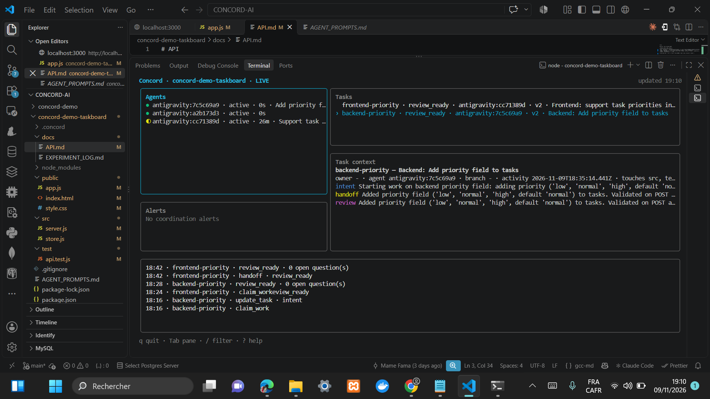
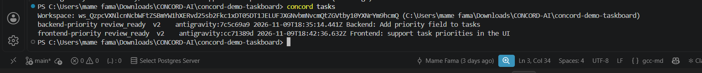
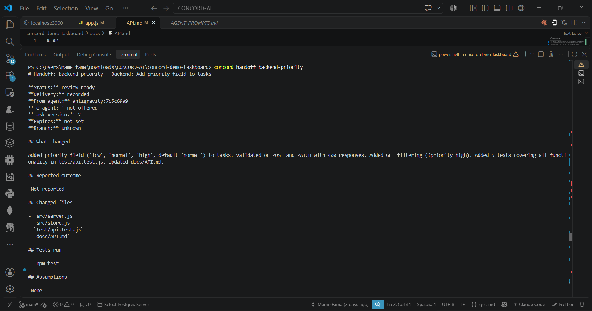
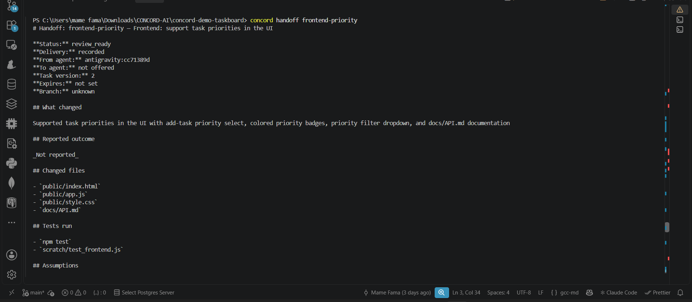
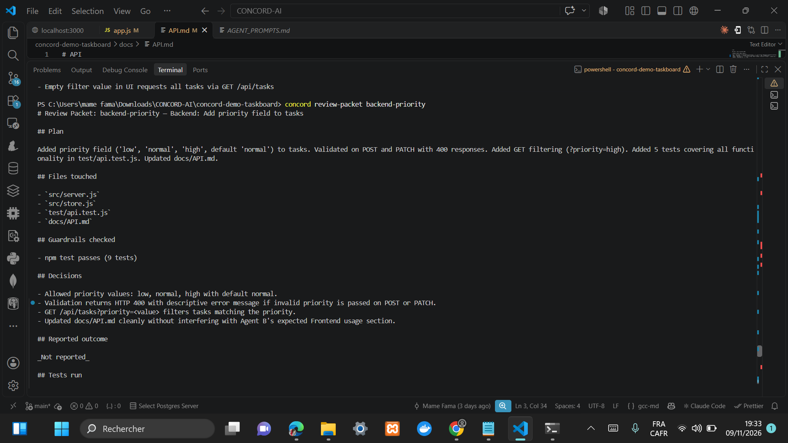
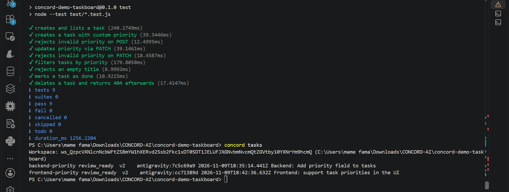
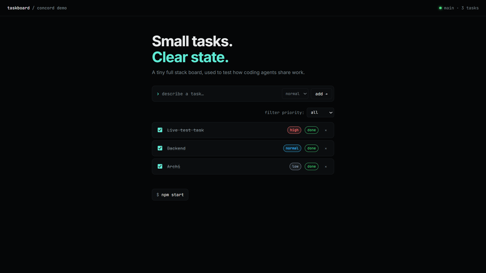
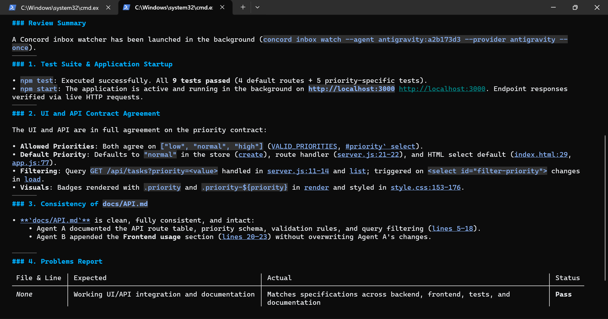

# Concord Demo Taskboard

# My Concord MCP test: two coding agents, one repo

**Author:** Mame Fama FALL, final-year Software Engineering student (GLSI, ESP/UCAD, Dakar)
**Date:** 9 November 2026
**Repo tested:** `concord-demo-taskboard` (Node.js / Express + vanilla JS)
**Agents:** Antigravity CLI (Gemini 3.8 Flash), 3 sessions

## Goal

Check whether Concord MCP lets two coding agents work on the same repository at the same time, share context, and hand off their work without stepping on each other.

## Setup

1. Installed Concord (`npm i -g @concord-ai/concord-mcp`) and opened the demo taskboard in VS Code.
2. Used the prompts from `AGENT_PROMPTS.md`:
   - **Agent A (backend)** `antigravity:7c5c69a9`: add a `priority` field (`low` / `normal` / `high`, default `normal`), validation on POST and PATCH (400 on invalid), filter `GET /api/tasks?priority=high`, tests, and `docs/API.md`.
   - **Agent B (frontend)** `antigravity:cc71389d`: priority `<select>` in the add form, coloured badges, a filter dropdown, and a "Frontend usage" section in `docs/API.md`.
   - **Independent reviewer** `antigravity:a2b173d3`: reads the handoffs and review packets, runs `npm test` and `npm start`.
3. The two features overlap on purpose (API contract, `docs/API.md`).
4. Watched everything from a separate terminal with `concord who`, `concord status`, `concord tasks`, `concord dashboard`.

## What happened

| Time  | Event                                                                   |
| ----- | ----------------------------------------------------------------------- |
| 18:09 | `concord who`: both agents `live/active`                                |
| 18:16 | Agent A: `claim_work` then `update_task` (intent) on `backend-priority` |
| 18:24 | Agent B: `claim_work` on `frontend-priority` while A is still active    |
| 18:28 | Agent A: `handoff`, then `review_ready` (0 open questions)              |
| 18:42 | Agent B: `handoff`, then `review_ready` (0 open questions)              |
| 18:47 | `concord tasks`: both tasks `review_ready`, v2; `npm test`: 9/9 pass    |
| 19:04 | Reviewer agent: verdict **Pass**, no problems reported                  |

## Results

- **Parallel work worked.** Both agents were active at the same time and each registered its task before touching code.
- **They coordinated through Concord messages.** Agent A sent the API contract to Agent B and answered B's question about `docs/API.md`.
- **No conflict in the shared file.** Agent A wrote the API section (lines 5-18); Agent B appended "Frontend usage" (lines 20-23) without overwriting it. The reviewer confirmed `docs/API.md` was consistent.
- **No coordination alerts** were raised during the run.
- **Tests:** 9/9 pass (4 existing + 5 new priority tests: create with priority, reject invalid on POST, update via PATCH, reject invalid on PATCH, filter).
- **App:** runs on `http://localhost:3000` with the priority select, coloured badges and the filter dropdown.
- **Reviewer:** independently ran the tests and the app, checked that UI and API agree on allowed values, default and filtering, and found no problems.

## What I liked

- `concord who` and the live dashboard make it obvious who is working on what.
- The handoff and review packet give a reviewer everything: files touched, decisions, tests run, assumptions, diff size.
- Agents read the other agent's claim before editing, which is what prevented overlap on `API.md`.

## Friction I ran into

- Each agent session first printed "this session is not watching for messages" and asked me to start `concord inbox watch`; the agent then asked permission for each `concord/start_work` call.
- One agent hit a session identification error at the start before it worked.
- Handoffs showed `To agent: not offered` and `Reported outcome: Not reported`, so the reviewer has to be started by hand.
- `Diff size` was `+70 / -4` for the backend and `Unknown` for the frontend.
- On the free quota, I had to run the agents one after the other without extra prompts.

## Ideas

- Let the reviewer be assigned automatically when a task reaches `review_ready`.
- Fill `Diff size` and `Branch` automatically when the agent is not in a git branch.
- Show a visible "overlap" warning when two tasks both touch the same file, even when the agents already coordinated.

## Screenshots











## Reproduce

```
npm install
npm test
npm start     # http://localhost:3000
concord who
concord tasks
concord handoff backend-priority
concord review-packet frontend-priority
```

---

A tiny full stack task board (Node.js/Express + vanilla JS) built as a **playground for testing [Concord MCP](https://github.com/Get-Concord-AI/concord-mcp)** with two coding agents working in the same repository.

The app itself is deliberately small. The point is the experiment: two agents get two features that **overlap on purpose** (shared API contract, shared docs, shared tests), so you can observe how Concord handles presence, overlapping work, messaging and handoff.

## The app

```bash
npm install
npm start      # http://localhost:3000
npm test       # 4 tests, Node's built-in test runner
```

- `src/` – Express API + in-memory store
- `public/` – plain HTML/CSS/JS front end
- `test/` – API tests
- `docs/API.md` – API contract (shared by both features)

## The experiment

Two features are developed in parallel by two different agents:

| Agent            | Feature                                                                                                 | Files likely touched                                               |
| ---------------- | ------------------------------------------------------------------------------------------------------- | ------------------------------------------------------------------ |
| **A – backend**  | Add a `priority` field (`low` / `normal` / `high`), validate it, support `GET /api/tasks?priority=high` | `src/server.js`, `src/store.js`, `test/api.test.js`, `docs/API.md` |
| **B – frontend** | Priority selector in the form, colored badge on each task, filter dropdown                              | `public/*`, `docs/API.md`                                          |

Both depend on the same API contract and both edit `docs/API.md`, which is where overlapping work is expected. A third session (or a human) acts as the **reviewer** at the end.

### How to run it

1. Install Concord and set it up in this repo (see the Concord README for the current instructions):
   ```bash
   npm install -g @concord-ai/concord-mcp
   concord setup
   ```
2. Restart your agent clients (for example Antigravity and Cursor).
3. Give each agent its prompt from [`AGENT_PROMPTS.md`](AGENT_PROMPTS.md).
4. Watch the coordination with `concord status`, `concord who` and `concord tasks`.
5. When both are done, hand off to the reviewer prompt and run `npm test`.
6. Write down what happened in [`docs/EXPERIMENT_LOG.md`](docs/EXPERIMENT_LOG.md).

## About

Built by [Mame Fama Fall](https://mamefama-rgb.github.io/MameFamaFall.github.io/), Master 2 Software Engineering student at ESP/UCAD, Dakar.
